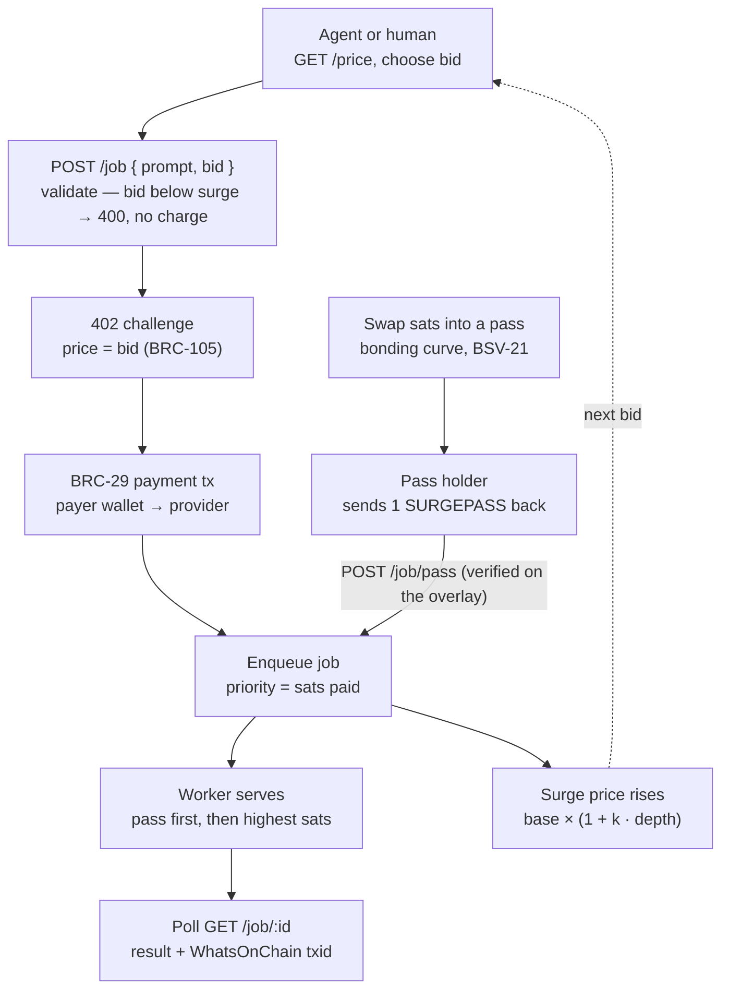

# SurgeUp

### Priority, priced in sats.

**A priority market for AI API calls, paid on BSV, with a token swap that agents use to jump the queue.**

Every call pays a surge price in sats that rises with queue depth. Callers can bid above it, and the highest bid is served next. SURGEPASS, a BSV-21 token sold on a bonding curve, is the DeFi core: when the surge is high, an agent swaps sats into a pass, sends it back and goes straight to the front. Agents pay from their own wallets; people pay from BSV Desktop.

Built for the TUM Blockchain & AI Hackathon 2026, BSV Blockchain track (DeFi Rails for Agentic Payments). *Formerly SurgeAPI.*

| | |
|---|---|
| **Live demo** | https://surgeup.vercel.app/ |
| **Usage and value note** | [VALUE.md](VALUE.md) |
| **Network** | BSV mainnet |

## Example transactions (mainnet, WhatsOnChain)

| What happened | Transaction |
|---|---|
| SURGEPASS token deployed (100 passes, BSV-21) | [8cc65b82…a69b](https://whatsonchain.com/tx/8cc65b822b07b26292e213c3c0654f7f36bc1e9e8e227e2e19790bf8c832a69b) |
| Logistics agent swaps 300 sats into SURGEPASS (pass sent to the agent) | [fb012752…1934](https://whatsonchain.com/tx/fb0127523875268c63a80abf375225eeb7361c0fb0f783c9cc389ceecdb31934) |
| Logistics agent sends the pass back and is queued at position 1 | [9e82a566…57d3](https://whatsonchain.com/tx/9e82a566ff2f27e90b67c072f3f40874aa041714c07f6920269e6b64ede957d3) |
| Logistics agent pays the surge, 150 sats, for its next task | [517b3306…cabb](https://whatsonchain.com/tx/517b33065d4e4fa6df1a66dd9213537a28a2c591d0b67d71b1034ebffae4cabb) |
| Finance agent pays a 225-sat bid | [98229f7c…773b](https://whatsonchain.com/tx/98229f7c6435bea98cd8fad1025433f2ab4e56c661beee6312dd1e58de96773b) |
| A person pays 100 sats for a job from BSV Desktop | [e545d649…dc12](https://whatsonchain.com/tx/e545d6490e3c46c460cda2f8bb9774d46d857f9bf02ffe4db27b3fa98e59dc12) |

Every row on the dashboard's Transaction history page links to its transaction the same way.

## How SurgeUp meets the track requirements

| Requirement | How |
|---|---|
| BSV TypeScript SDK and Wallet Toolbox | `@bsv/sdk` for transactions, BRC-29 payments, AuthFetch and BSV-21 scripts; `@bsv/wallet-toolbox` for the provider and agent wallets; `@bsv/auth-express-middleware` and `@bsv/payment-express-middleware` (BRC-103/104 auth, BRC-105 paid HTTP). |
| BSV wallets for user flows | The dashboard connects to BSV Desktop with `WalletClient('auto')` (BRC-100): pay for a job, connect a profile, fund the agents. |
| Real transactions | All payments, swaps and the token deploy are on mainnet (table above). |
| Non-custodial | Each payment goes straight from the payer's wallet to the provider's. The server never holds anyone else's funds, and keys never leave their wallet. |
| An AI agent pays | Six domain agents (finance, healthcare, legal, logistics, research, e-commerce) pay per call from their own wallet, choosing between the surge and a SURGEPASS swap; an optional Claude mode picks each bid within a hard budget. |
| DeFi product at the core | The SURGEPASS bonding-curve swap: sats → BSV-21 token, priced from on-chain circulation (below). |

## Architecture


Payments go straight from the payer's wallet to the provider's wallet. The server never holds anyone else's funds.

## Data flow of one job



A pass holder skips payment and enters the queue at position 1.

### The SURGEPASS swap

The DeFi core: anyone swaps sats into SURGEPASS (BSV-21, 100 supply) at a bonding-curve price, `300 + 50 × passes in circulation` sats. Circulation is read from the overlay (supply minus the provider's balance), so a redeemed pass returns to the provider and the price falls again. `GET /swap` publishes the price and curve; `POST /pass` charges it, refuses before payment when sold out, when the overlay cannot quote, or when the price is above the buyer's `maxSats`. Agents compare their surge bid with the pass price on every task: when the pass is cheaper they swap, send the pass back and redeem it with `POST /job/pass`; otherwise they pay the surge in sats.

## Run it locally

Needs Node 22+, BSV Desktop (desktop.bsvb.tech) and a few thousand sats.

```bash
npm install
npm run keygen          # creates wallet keys in .env (never printed, never committed)
npm run overlay         # BSV-21 token overlay on :8080 (leave running)
npm run server          # SurgeUp API on :3000 (leave running)
npm run web             # dashboard on http://localhost:5173
```

Then fund the agents and turn on the swap. Both move real sats, so you approve them yourself:

```bash
npm run fund -- 10000   # pays each agent wallet from BSV Desktop (BRC-29)
npm run deploy-pass     # deploys SURGEPASS; add the printed PASS_TOKEN_ID line to .env, restart the server
```

Open the dashboard's **Agent** page, pick agents and a budget, and click **Run agents**, or pay for a job yourself with BSV Desktop.

| Variable (`.env`, see `.env.example`) | Purpose |
|---|---|
| `PROVIDER_KEY`, `AGENT_*_KEY` | Wallet keys, created by `npm run keygen` |
| `PASS_TOKEN_ID` | SURGEPASS token; passes and the swap stay off until it is set |
| `OVERLAY_URL`, `SURGE_URL` | Defaults `http://localhost:8080` and `http://localhost:3000` |
| `ANTHROPIC_API_KEY` | Optional: Claude mode for the agents |
| `AGENT_RUN_TOKEN` | Optional: require a token to start agent runs on a public deploy |

The public demo serves the dashboard from Vercel and rewrites API routes to this server through a Cloudflare tunnel (`npm run tunnel`).

## Tests

```bash
npm test                # 43 tests on wallet-toolbox's mock chain: real wallets, auth, payments, overlay
npm run typecheck
```

## Project layout

| Path | What |
|---|---|
| `src/server.ts` | HTTP API: surge pricing, BRC-105 payments, `/pass` swap, `/job/pass`, `/swap`, agent console |
| `src/market.ts` | Priority queue and surge price |
| `src/pass.ts` | SURGEPASS bonding curve, issue and redeem against the overlay |
| `src/agentRuns.ts`, `src/agent.ts`, `src/llmAgent.ts` | Rule-based and Claude agents that pay from their own wallets |
| `src/kit/` | BSV-21 token kit and overlay (from the BSV starter kit) |
| `web/` | Dashboard (Vite, vanilla TypeScript) |
| `test/` | End-to-end tests on the mock chain |

## License

[MIT](LICENSE)
