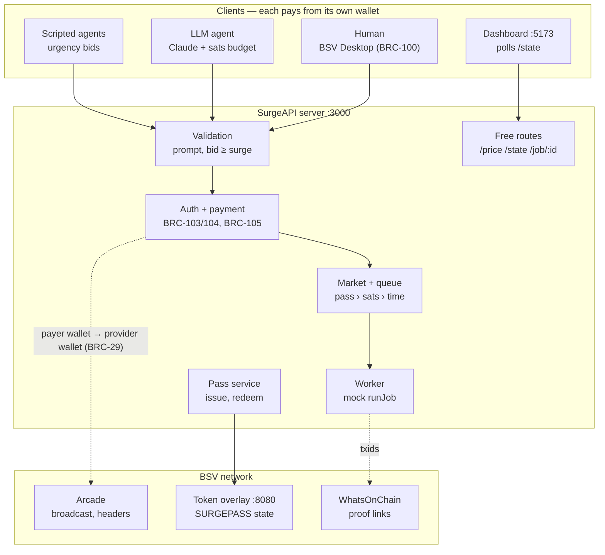
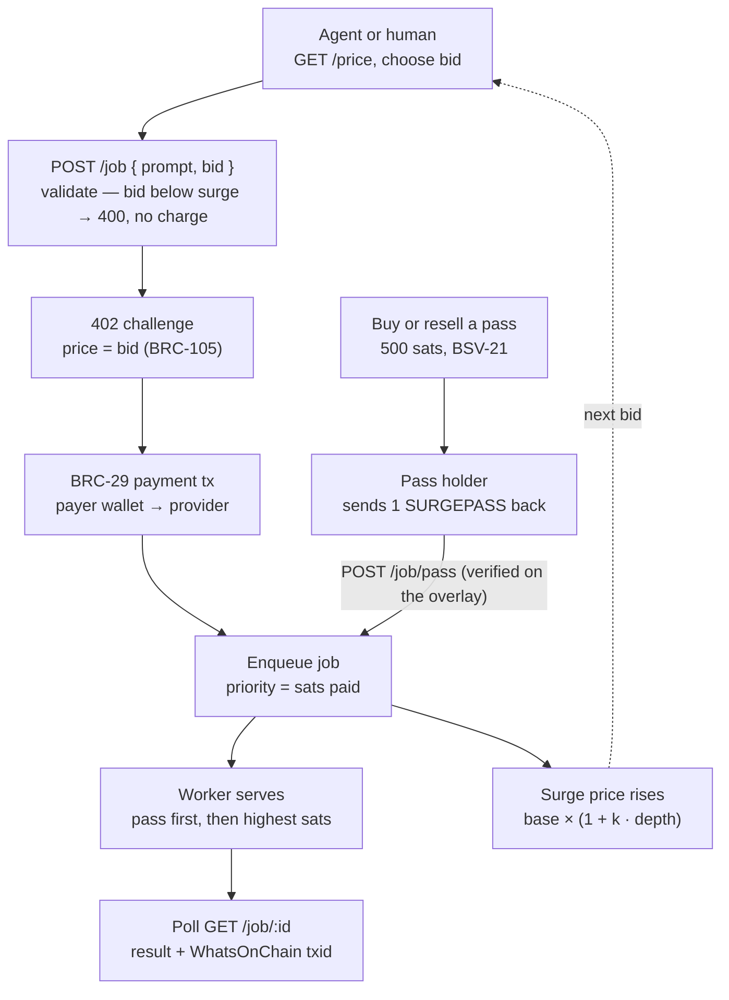

# SurgeAPI

**A pay-per-call AI API on BSV with a live priority market.** Every call pays a surge price in sats that rises with queue depth; callers can bid above it, and the highest-paid job is served next. AI agents pay for themselves from their own wallets. A BSV-21 priority pass lets a holder jump the queue, and it can be resold.

Built for the TUM Blockchain & AI Hackathon 2026 — BSV Association track. Work plan: [TASKS.md](TASKS.md).

> Setup, demo links and the value note are filled in by task T9.

## Architecture

Payments go straight from the payer's wallet to the provider's wallet. The server never holds anyone else's funds.

## Data flow of one job

A pass holder skips payment and enters the queue at position 1.
